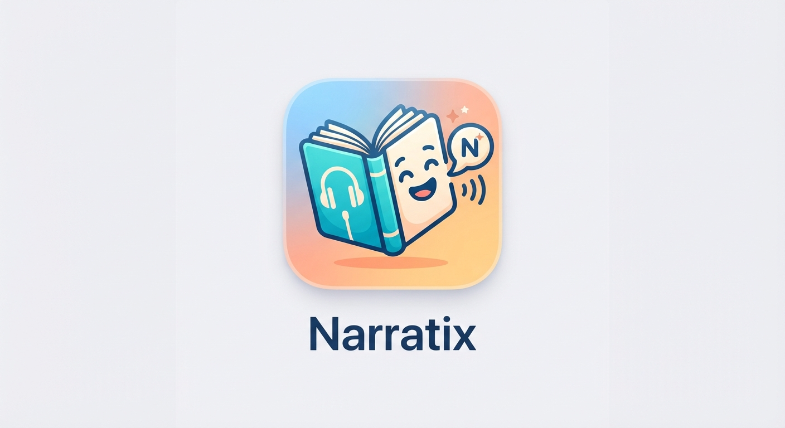

# Narratix — Audiobook Player for iOS & watchOS

<div align="center">



[](https://github.com/alzimerahmed/Narratix)
[](https://github.com/alzimerahmed/Narratix)
[](https://github.com/alzimerahmed/Narratix)
[](https://github.com/alzimerahmed/Narratix/actions/workflows/ci.yml)
[](LICENSE)

*Your books, narrated your way — an offline-first audiobook player for iPhone, iPad, Apple Watch, and CarPlay.*

[Download](https://github.com/alzimerahmed/Narratix/releases) • [Features](#features) • [Building](#building)

</div>

---

## Features

| | |
|---|---|
| **Import** | AirDrop, Files, iTunes File Sharing, zip archives, share extension, WebDAV, or your own Jellyfin / AudiobookShelf server |
| **Listen** | Chapters, playback speed presets, smart rewind, volume boost + EQ (voice boost), sleep timer, lock-screen & headset controls |
| **Manage** | Folders & bound books, collections & tags, series browsing, bookmarks with notes, drag & drop sorting, per-book notes |
| **Continue** | Playback history, position restore, up-next queue, auto-bookmark on pause/sleep, DNF/finished triage |
| **Track** | Reading stats v2 — streaks, goals, graphs; Hardcover reading-progress sync |
| **Sync** | Cloud library sync with S3 multipart uploads, standalone Apple Watch playback, storage management with library rescan |
| **Access** | VoiceOver, Dynamic Type, dark mode + themes, 24 languages, Siri & App Intents, CarPlay |

## Screenshots

Coming soon — device-frame captures will be added as the UI settles post-rebrand.

## Tech Stack

| Layer | Technology |
|---|---|
| Language | Swift 5 (Xcode 27.1 toolchain) |
| UI | UIKit coordinators + SwiftUI MVVM |
| Platforms | iOS 26.0, watchOS 10.0 |
| Persistence | CoreData (library, staged migrations v1–v14) + SwiftData (sync queue) |
| Audio | AVFoundation (AVAudioSession, MTAudioProcessingTap EQ pipeline) |
| Networking | JellyfinAPI, AudiobookShelf, WebDAV, Hardcover, S3 multipart |
| Subscriptions | RevenueCat (account tiers) |
| Observability | Sentry |
| Tooling | SwiftLint, SwiftFormat, Sourcery, GitHub Actions CI |

## Project Structure

```
BookPlayer.xcodeproj          9 native targets (app, watch, widgets, extensions, tests)
├── BookPlayer/               iOS app source (Player, Library, Settings, Profile, Import…)
│   ├── Jellyfin/             Media-server integrations (Jellyfin, AudiobookShelf, Hardcover)
│   └── *.lproj/              24 translated locales
├── BookPlayerWatch/          watchOS app
├── BookPlayerWidgets/        Home-screen + lock-screen widgets
├── BookPlayerShareExtension/ Share-sheet import
├── Shared/                   Code compiled into both iOS + watchOS frameworks
│   ├── CoreData/             Library store (App Group container, staged migrations)
│   ├── SwiftData/            Sync-task queue store (ModelActor repository)
│   └── Services/             Account, sync engine, library service
├── BuildConfiguration/       xcconfig build settings (secrets via template)
└── ci_scripts/               Xcode Cloud post-clone hooks
```

## Building

Requires **Xcode 27.1** (iOS 26 / watchOS 10 SDKs).

```bash
cp BuildConfiguration/Debug.template.xcconfig BuildConfiguration/Debug.xcconfig
# fill in the BP_* values, then:
xcodebuild -resolvePackageDependencies
open BookPlayer.xcodeproj
```

<details>
<summary>CI & verification</summary>

CI (`.github/workflows/ci.yml`) builds and runs `BookPlayerTests` on every push to `main`/`develop` and PRs to `develop`. The workspace is edit-only on non-macOS machines — all builds and tests run on GitHub Actions; release builds come from Xcode Cloud via `ci_scripts/`.

</details>

## Usage

1. Launch Narratix and grant library access.
2. Import audiobooks — drag files in, share them from another app, or connect a Jellyfin/AudiobookShelf server from **Profile → Media servers**.
3. Tap a book to resume exactly where you left off; chapters, speed, and sleep timer live in the player.

## FAQ / Troubleshooting

**Why do builds need an xcconfig?** — Secrets (Sentry DSN, API domain, RevenueCat key) are injected at build time via `BP_*` build settings; the tracked `Release.xcconfig` ships with `replace.me` placeholders and `Debug.xcconfig` is never committed.

**Where did the Tip Jar / Plus upsell go?** — Removed. All features (themes, app icons, streaming, sync surfaces) are freely available in Narratix.

## Contributing

Fork → branch (`feature/…` or `fix/…`) → PR into `develop`. Conventional Commits (`type(scope): description`) are enforced; CI must be green before merge.

## Roadmap

- [x] Playback history, queue, auto-bookmarks, DNF triage, per-book notes
- [x] Collections/tags, series browsing
- [x] WebDAV import, storage management, cover-art fetch
- [x] EQ + voice boost
- [x] Stats v2, watch library browse
- [ ] Read-along (EPUB + on-device transcription)
- [ ] CarPlay sleep-timer presets
- [ ] Lock-screen Live Activity

## Changelog

See [Releases](https://github.com/alzimerahmed/Narratix/releases).

## License

GPL-3.0 — see `LICENSE`. Narratix is a fork of [BookPlayer](https://github.com/TortugaPower/BookPlayer); upstream copyright is preserved per the license.
